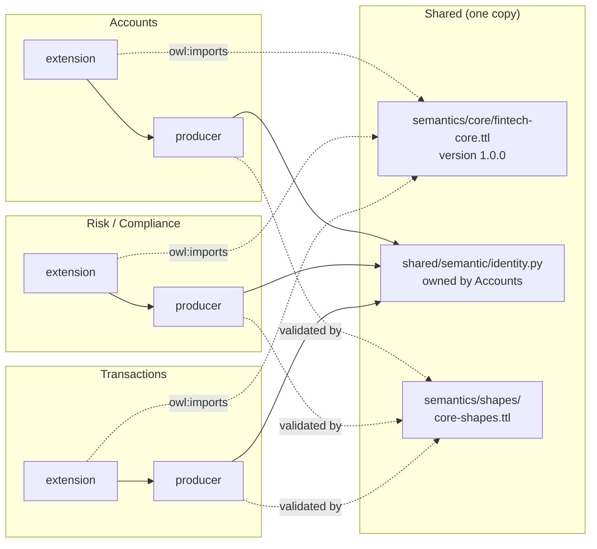
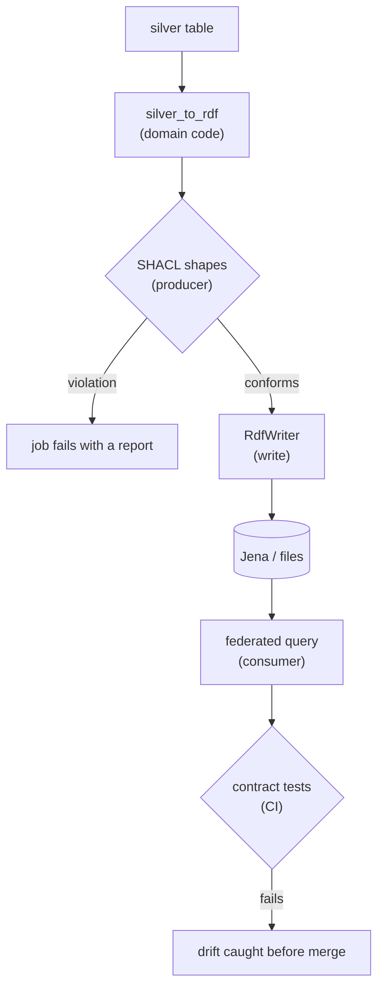

# Semantic drift: before and after

Article 2 of the data mesh series uses this repository as evidence. The semantic layer
drifted: the published ontology, the producers, and the consumers stopped agreeing, and
nothing failed. This page shows each drift, the file where it lived, the fix, and what
now catches it.

The drifted design is kept on purpose. It is frozen, runnable, and documented, so you
can compare it with the fix.

See [Before: the drifted design](semantic-drift-before.md) and
[After: the fixed design](semantic-drift-after.md) for each side on its own.

!!! tip "Reproduce the before state"
    ```bash
    git checkout semantic-drift-before     # the whole repo as it was at 44f2cba
    ls examples/semantic-drift/before/     # the frozen copies of the drifted files
    ```

## The drifts and the fixes

| # | Drift | Before (file and behavior) | After (file and behavior) | Caught now by |
|---|---|---|---|---|
| D1 | Competing link names | The published ontology said `riskCustomer`; producers and the federated query used `forCustomer`. Same split for `email`/`customerEmail`, `name`/`customerName`, `accountCustomer`/`accountOwner`. A query written from the published core returned zero rows with no error. | One name per link, in `semantics/core/fintech-core.ttl`. Losers are `owl:deprecated` with `owl:equivalentProperty` pointing at the winner. | `NoDeprecatedTermsShape` in `semantics/shapes/core-shapes.ttl` |
| D2 | Four "shared" ontologies | Docs copy (365 lines) plus three per-domain test copies (78, 72, 70 lines), all different. | One core file. Test copies deleted. Tests and configs load `semantics/core/fintech-core.ttl`. | Contract tests load the single file |
| D3 | Identity rule copied three times | `IriResolver` (Accounts) and two `CrossDomainResolver` copies each implemented SHA-256(email \| kyc_id). Each copy's tests checked only itself. | One library, `shared/semantic/identity.py`, owned by Accounts. Every resolver delegates to it. | `tests/contract/test_identity_vectors.py` runs golden vectors through every domain's code path |
| D4 | 32-bit identifiers | Hash truncated to 8 hex characters. Collisions at about 77,000 customers reach 50%. | Full 64-hex HMAC-SHA256 digest. | Shape pattern `^https://chakracommerce.com/customer#[0-9a-f]{64}$`; golden vectors include the collision pair |
| D5 | Email-derived identity | Unkeyed hash of a low-entropy identifier, reversible by guessing. | HMAC keyed by `FINTECH_IRI_KEY`. There is no default key. | `test_missing_key_refuses_to_mint`; key runbook in [the migration guide](semantic-core-migration.md) |
| D6 | Numbers that are not numbers | Amounts typed `fintech:decimal` (defined nowhere) and built from Python `float`. `SUM` raised a type error. | `xsd:decimal` built from `Decimal(str(value))`. Dates are `xsd:dateTime`. | `accountBalance`, `transactionAmount` and `riskScore` datatype shapes; `SUM` demo |
| D7 | No validation | No SHACL shapes. Nothing checked a producer's output against the core. | Shapes in `semantics/shapes/`. `RdfWriter` for Accounts and Transactions validates before writing and raises on violation. | `shared/semantic/validation.py`; `demo_shacl_catches_drift.py` |
| D8 | Two churn queries | `domains/federation/queries/` and the docs copy differed. The copy selected `?ticketCount`, which nothing binds. | One query, `domains/federation/queries/churn-analysis-federated.sparql`. The docs copy is removed. The failed-transaction count is an aggregate, and the unbound `?ticketCount` is gone. | `tests/contract/test_federated_churn.py` checks every selected variable is bound and that the known customer comes back |

## Empty join (D1)

The before consumer followed the published core and joined on `riskCustomer`. The after
consumer joins on the core name `forCustomer`. Both run against the producers' output
from the same sample data.

**Before**, query written from the published core:

```sparql
PREFIX fintech: <https://chakracommerce.com/ontology/fintech/>
SELECT ?customerEmail ?riskScore WHERE {
  ?profile fintech:riskCustomer ?customer ;
           fintech:riskScore ?riskScore .
  ?customer fintech:customerEmail ?customerEmail .
  FILTER (?riskScore > 0.8)
}
```

Result: `0 row(s)`, with no error.

**After**, query written from core 1.0.0 is the same, with `forCustomer` in place of
`riskCustomer`. Result:

```
after, query written from the core 1.0.0 (forCustomer): 1 row(s)
    customerEmail=john@acme.com  riskScore=0.92
```

## Identity collision (D3, D4)

These two customers collided under the drifted rule:

| Customer | KYC ID | Before IRI | After IRI |
|---|---|---|---|
| `customer111830@example.com` | `KYC0111830` | `customer#15e5a0c2` | a 64-hex digest |
| `customer130865@example.com` | `KYC0130865` | `customer#15e5a0c2` | a different 64-hex digest |

The before pair collides; the after pair does not. Birthday-bound odds of at least one
collision among the customers:

| Customers | 32-bit (8 hex, before) | 256-bit (64 hex, after) |
|---:|---:|---:|
| 10,000 | 1.16% | about 4 × 10⁻⁷⁰ |
| 77,000 | 49.85% | about 3 × 10⁻⁶⁸ |
| 100,000 | 68.78% | about 4 × 10⁻⁶⁸ |
| 1,000,000 | 100.00% | about 4 × 10⁻⁶⁶ |

Before, three semantic modules computed SHA-256 for customer IRIs. After, only
`shared/semantic/identity.py` does.

## Numbers that are not numbers (D6)

`SUM` over the before amounts fails:

```
before, amounts typed fintech:decimal:
  error: SPARQLTypeError: ... does not have a numeric datatype!
after, amounts typed xsd:decimal:
  total: 4500.0
```

## Producer output against the shapes (D1, D4, D6, D7)

Validating the before output against the current shapes:

```
[D1] 0 violations: producers emitted fintech:forCustomer, so the drift lived in the published core and consumer queries
[D4] 11 violation(s), customer IRI is not the 64-hex identity-library digest.
[D6] 22 violation(s), amount or date not typed xsd:decimal / xsd:dateTime.
  Conforms: False
```

The after output conforms. D1 shows zero violations in producer output because the
producers already wrote `forCustomer`. The drift was in the published core and in the
consumers' queries, which the shapes do not see. The `NoDeprecatedTermsShape` rejects
any graph that does use a deprecated name, and the empty-join demo shows the consumer
side.

## The federated churn query (D8)

The one query every domain shares. The contract test rewrites each `SERVICE` clause to a
named graph and runs the query against real producer output.

```sparql
--8<-- "domains/federation/queries/churn-analysis-federated.sparql"
```

## Architecture

Each domain owns its entities and extensions. The core and the identity rule are shared,
and nothing else is.



## Where drift is caught

Drift used to surface in consumers, silently. The fix moves detection to the producer,
where a failed job is visible, and keeps the consumer side covered by tests.



## Run the demos

```bash
pip install -r requirements.txt       # includes pyshacl
make semantic-drift-demo              # runs all four demos
```

The demos are in `examples/semantic-drift/`. Each one runs the frozen before code and
the current after code on the same data.

| Demo | Shows |
|---|---|
| `demo_empty_join.py` | D1: the same join returns 0 rows before and 1 row after |
| `demo_identity_collision.py` | D3, D4: the collision pair, and the collision odds |
| `demo_decimal_sum.py` | D6: `SUM` fails before and returns the total after |
| `demo_shacl_catches_drift.py` | D1, D4, D6, D7: the shapes report the before drift and pass the after output |

## Known gap (article 3)

The Fuseki configs expose open SPARQL update and graph-store read/write endpoints, and
the Accounts graph serves customer names and emails unmasked. This change does not fix
either one. It is a second read path that governance must cover, and it is tracked for
article 3.
